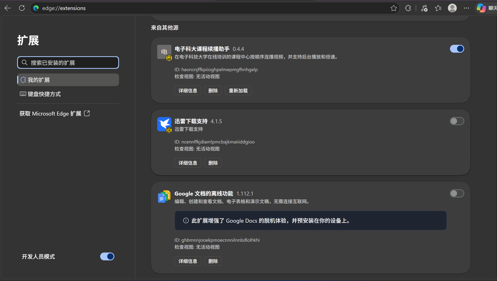
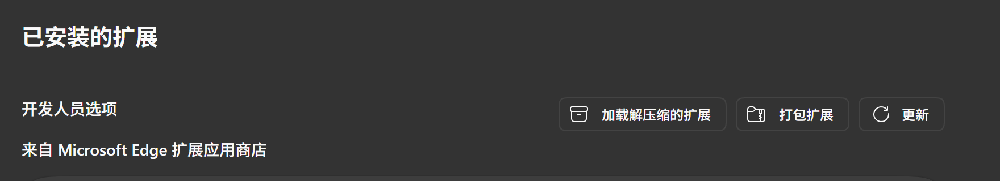

# UESTC电子科大党课助手

面向电子科技大学在线培训平台的 Chrome 和 Edge 扩展。支持按课程目录连续播放必修视频、跳过已完成分集、切换标签页时续播，并可选择 1× 至 8× 播放速度。

**当前版本 0.4.4**。安装后，浏览器扩展列表显示「电子科大课程续播助手」。

## 功能

| 功能 | 使用方式和行为 |
| --- | --- |
| 全课程连播 | 在课程中心点击「全课程连播」，按页面课程顺序查找待播视频。从课件列表或播放页开始时，从当前位置往后续播。 |
| 当前合集续播 | 在视频播放页点击面板里的「开启」，连续播放同一课件的后续分集。 |
| 必修筛选 | 在「讲义学习」「精品课程」和「延伸阅读」中按分页和分集顺序查找明确标记为「必修」的视频，跳过选修、未明确标记为必修以及已完成的内容。「视频资料」区块不参与全课程连播，自测和非视频内容由你手动完成。 |
| 已完成分集跳过 | 播放前读取课件目录的完成标记。当前集或后续分集已完成时自动跳过，完成状态以平台目录为准。 |
| 倍速 | 支持 1×、1.25×、1.5×、1.75×、2×、2.5×、3×、3.5×、4×、5×、6×、7×、8×。默认 1×，选择会在当前标签页内沿用到下一集。面板显示播放器报告的实际倍速。 |
| 后台播放 | 开启助手后，切换标签页或窗口时会尝试维持播放。遇到浏览器限制时，可回到课程页再试。关闭课程标签页会结束该次连播。 |
| 从上次进度续播 | 平台出现「继续观看」时，助手会选择继续播放。视频自然结束后，助手会留出时间让平台保存进度，再继续查找下一项。 |

## 安装

1. 在 GitHub 仓库主页点击 **Code → Download ZIP**，将 ZIP 解压到一个准备长期保留的位置。确认解压出来的项目文件夹中可以直接看到 `manifest.json`、`catalog.js`、`course.js` 和 `player-bridge.js`。
2. 在 Edge 地址栏输入 `edge://extensions`，打开左下角的「开发人员模式」。Chrome 用户打开 `chrome://extensions`，启用「开发者模式」。

   

3. 在 Edge 顶部点击「加载解压缩的扩展」。Chrome 中对应按钮为「加载已解压的扩展程序」。

   

4. 在弹出的窗口中选择**直接包含 `manifest.json` 的文件夹**，然后确认。回到扩展管理页面，检查「电子科大课程续播助手」卡片显示 **0.4.4**，且右侧开关已打开。
5. 在电子科技大学在线培训平台正常登录，打开或刷新课程中心、课件列表或视频播放页。在页面右下角找到「课程续播助手」。选择「全课程连播」开始，或在播放页选择「开启」仅续播当前合集。

## 使用和排查

- **找不到助手面板**。检查扩展是否已启用，再刷新课程页。扩展匹配培训站点下的 `/jjfz/lesson*` 和 `/jjfz/play*` 页面。
- **提示状态检查失败**。点击「重试状态检查」，确认课件目录可以正常打开。
- **视频没有声音或没开始**。浏览器拦截有声自动播放时，助手可能会尝试静音播放。可回到课程页手动开始，并在播放器里开启声音。
- **暂停或退出连播**。手动暂停后可从播放器恢复。点助手右上角「关闭」结束自动切课。遇到需要你处理的平台提示时，按页面提示操作。
- **更新扩展**。将新版本解压到原文件夹并替换文件，在扩展管理页点击该扩展卡片上的「重新加载」，再刷新课程页。如果换了目录，就从新目录重新加载扩展。

## 登录与进度

使用平台原有登录页面和当前浏览器会话。扩展清单将脚本限定在培训站点的课件和播放页面。进度是否完成，以培训平台的课程目录显示为准。

如果它对你有帮助，欢迎在 GitHub 点击 **Star**。

## 使用说明与测试范围

- **入党积极分子党课：已通过测试。** 目前确认可用的课程范围为入党积极分子培训课程。
- **发展对象党课：尚未测试。** 该类别的课程目录识别、续播和完成状态检查仍待验证。
- 课程是否完成以培训平台显示的进度为准。自测、非视频学习内容和需要确认的提示请按平台要求手动处理。
- 后台播放和实际倍速受浏览器与平台播放器影响。遇到暂停或倍速异常时，可以回到课程页查看播放器状态。
